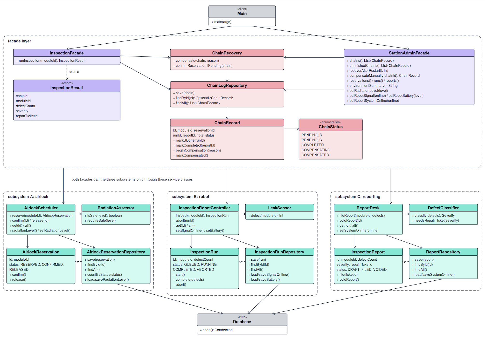
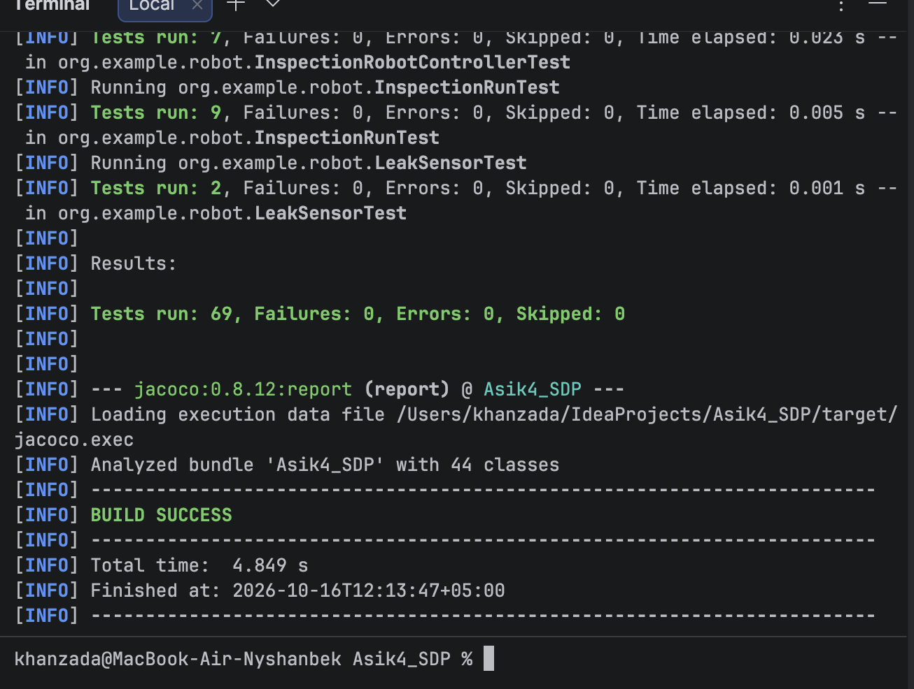

# Space Station Inspection Robot Assignment 4: Facade
A Java console application. A robot inspects a module of a space station. One inspection is a chain of three independent subsystems, run through a facade. State is saved in SQLite, so it survives a restart, and finished work is undone when a later step fails.
- A (airlock): checks the module id and radiation, and reserves an airlock slot.
- B (robot): checks battery and signal, scans the module for leaks and records the run.
- C (reporting): classifies the defects, files a report and opens a repair ticket if defects were found.

The client calls `InspectionFacade.runInspection(moduleId)` and does not talk to A, B or C directly.

## How to run
Requirements: JDK 17 or newer and Maven.
```
mvn clean compile exec:java     # build and start the console menu
mvn clean test                  # run all 69 tests and create the coverage report
```
The coverage report is in `target/site/jacoco/index.html`.
The program creates `station.db` in the folder where it starts. Another file can be given as the first argument: `mvn exec:java -Dexec.args="demo.db"`.

Reset the saved data to a clean state: choose option 10 in the menu and type `yes`, or stop the program and delete the file `station.db`.

## Console menu
1 run an inspection, 2 show everything that is saved, 3 change radiation, 4 robot signal on/off, 5 robot battery, 6 report system on/off, 7 recover unfinished chains, 8 compensate one chain by hand, 9 simulate a crash in the middle of a chain, 10 reset the database, 0 exit.
A module id has the form `MODULE-4` (capital letters, a dash and a number). Use option 2 after every step to see what is saved.

How to show each case:
- Normal run: option 1 with `MODULE-4`. The chain is COMPLETED, the reservation CONFIRMED, the report FILED.
- B fails after A: option 4 off, then option 1 with `MODULE-5`. The robot loses its signal. Only the airlock reservation is RELEASED. The chain has no robot run. Switch the signal on again with option 4.
- C fails after A and B: option 6 off, then option 1 with `MODULE-7`. The report system is offline. The robot run is ABORTED, then the reservation is RELEASED, and the report is VOIDED. Switch the report system on again with option 6.
- Nothing starts: option 3 with `5.0` then option 1 (unsafe radiation), or an invalid id such as `abc`. Nothing is saved. Set the radiation back to `0.2`.
- Restart in the middle of a chain: option 9, then option 2 with `MODULE-4` (a chain waiting for the report). Exit with 0 and start the program again. Option 2 shows the chain is still PENDING_C on disk. Option 7 recovers it: the run is ABORTED and the reservation RELEASED.

Failures come from saved state (radiation level, robot signal, battery, report system), not from flags inside the facade.

## UML class diagram

The diagram shows the client, both facades, the chain journal and the three subsystems with their associations. Subsystems A, B and C never depend on each other.

## Design
Each subsystem has 4 classes (12 in total): a service as the entry point, a business logic class, an entity with a status, and a repository that talks to SQLite.
- A: `AirlockScheduler`, `RadiationAssessor`, `AirlockReservation`, `AirlockReservationRepository`.
- B: `InspectionRobotController`, `LeakSensor`, `InspectionRun`, `InspectionRunRepository`.
- C: `ReportDesk`, `DefectClassifier`, `InspectionReport`, `ReportRepository`.

Entities and statuses. Each entity rejects illegal changes by itself with `IllegalStatusTransitionException`, independently of the facade.
- `AirlockReservation`: RESERVED, CONFIRMED, RELEASED. RESERVED can become CONFIRMED or RELEASED; both are final.
- `InspectionRun`: QUEUED, RUNNING, COMPLETED, ABORTED. A run starts, then completes. It can be aborted while queued, running or completed. ABORTED is final.
- `InspectionReport`: DRAFT, FILED, VOIDED. A draft is filed. A draft or a filed report can be voided. VOIDED is final.

No subsystem imports another one. They only meet inside the facade layer. Every repository gets its connection from `Database`.

Two facades:
- `InspectionFacade.runInspection(moduleId)` runs A, B and C, saves the progress after every step and compensates when a step fails.
- `StationAdminFacade` shows the saved state, recovers unfinished chains, compensates a chain by hand and changes the demo environment.

Durable state. Each subsystem has its own tables. The facade also keeps a journal table `inspection_chain` with the chain status (PENDING_B, PENDING_C, COMPLETED, COMPENSATING, COMPENSATED) and the ids of the A, B and C records of the chain (`ChainRecord`, `ChainLogRepository`).

Compensation depth is decided from what is saved on disk (`ChainRecovery.compensate`). If the saved chain has no robot run id, only A is released. If it has a run id, B is aborted first and then A is released. The same code runs after a failure and after a restart. Both undo steps can safely be repeated.

| Failure | Already saved | What happens |
|---|---|---|
| Invalid module id, unsafe radiation, no free airlock slot (step A) | nothing | error is returned, nothing to undo |
| Robot loses signal or battery is too low (step B) | A's reservation | A is released |
| Report system is offline (step C) | A's reservation and B's run | B is aborted, then A is released; the report is voided |
| Program stops in the middle of a chain | whatever was saved | after a restart, option 7 undoes the right part from the saved status |

Own exception types are in `org.example.error` and all extend `StationException`.

## Principle of Least Knowledge: before and after
Before: the client talks to all three subsystems.
```java
AirlockReservation reservation = airlockScheduler.reserve(moduleId);
InspectionRun run;
try {
    run = robotController.inspect(moduleId);
} catch (RuntimeException e) {
    airlockScheduler.release(reservation.getId());
    throw e;
}
InspectionReport report;
try {
    report = reportDesk.fileReport(moduleId, run.getDefectCount());
} catch (RuntimeException e) {
    robotController.abort(run.getId());
    airlockScheduler.release(reservation.getId());
    throw e;
}
airlockScheduler.confirm(reservation.getId());
String severity = reportDesk.get(report.getId()).getSeverity().name();
```
This client has many friends: three services (`AirlockScheduler`, `InspectionRobotController`, `ReportDesk`) and three entity types (`AirlockReservation`, `InspectionRun`, `InspectionReport`). It also uses a deep chain, `reportDesk.get(report.getId()).getSeverity().name()`, which reaches a friend of a friend of a friend. The order of the steps and the rollback rules are spread over the client, and no progress is saved if the program stops.

After: the client uses the facade.
```java
InspectionResult result = inspectionFacade.runInspection(moduleId);
String severity = result.severity();
```
The client has one immediate friend, `InspectionFacade`, and receives a plain value object, `InspectionResult`. The facade does the sequencing, saves the progress and compensates on failure.

## Why Facade and not Adapter
An Adapter makes an existing interface match the interface a client expects. Its question is: these two interfaces do not fit, how do I convert one into the other? Nothing like that happens here. `AirlockScheduler`, `InspectionRobotController` and `ReportDesk` already have clean interfaces, and the client does not expect any other shape from them.
Our problem is different. The client wants one simple operation, "inspect this module". Doing it correctly means calling three unrelated subsystems in the right order, remembering how far the chain got, and undoing the right part of it when a later step fails. That is the intent of a Facade: give one simpler interface to a group of subsystems and hide how they are coordinated. The facade adds knowledge (the sequence, the chain journal, the compensation depth) instead of translating a method signature. With three adapters the client would still have to run the chain itself, so the real problem would stay unsolved.

## Each subsystem on its own
`org.example.standalone.AirlockStandalone`, `RobotStandalone` and `ReportingStandalone` each have a `main` method that uses one subsystem without any facade. Run them from the IDE. Each one creates its own small database file, uses the subsystem and prints what it saved.

## Tests and coverage
- 69 JUnit 5 tests: unit tests of the three subsystems and of `Database`, and facade tests.
- F.I.R.S.T.: every test uses its own temporary database (`@TempDir`), so tests are fast, independent and repeatable. Every test asserts its result.
- Testing language: `StationScenario` makes tests read like sentences, for example `aStation(dir).reportSystemGoesOffline().inspecting("MODULE-7").thenTheOnlyChainIs(COMPENSATED)`.
- `InspectionChainTest` tests both compensation depths and checks the saved end state.
- `RestartTest` leaves a half finished chain on disk, reopens the application and checks that the facade recovers from the saved status (PENDING_B and PENDING_C), also when recovery runs twice.
- Coverage is measured with JaCoCo (`mvn clean test`). Line coverage: airlock 93%, robot 94%, reporting 94%, facade 90%, chain 91%. The 80% requirement applies to the subsystems and the facades. `Main`, `app` and `standalone` are demo tools.



## Project structure
```
pom.xml
README.md
uml.png
jacoco.png
src/main/java/org/example/
  Main.java        console menu (the client)
  facade/          InspectionFacade, StationAdminFacade, InspectionResult
  chain/           ChainRecord, ChainStatus, ChainLogRepository, ChainRecovery
  airlock/         subsystem A
  robot/           subsystem B
  reporting/       subsystem C
  infra/           Database (SQLite connection)
  error/           own exception types
  app/             StationContext (wiring), DemoCrashSimulator, FacadeDemo
  standalone/      each subsystem without the facade
src/test/java/org/example/
  facade/          StationScenario (testing language), InspectionChainTest, RestartTest, AdminFacadeTest
  airlock/ robot/ reporting/ infra/    unit tests
```

## Known limitations
A crash after step A saved its reservation but before the chain row is saved leaves a reservation that the journal does not know. A crash inside step B leaves an unfinished run record. A real system would use a transactional outbox. `DemoCrashSimulator` (menu option 9) is only a demo tool: it writes a half finished chain straight to disk.